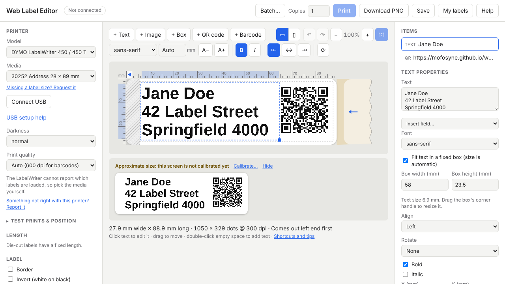
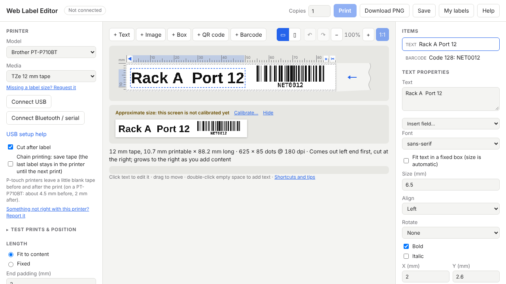

# Web Label Editor

Design labels and print them **straight from your browser** to DYMO
LabelWriter and Brother P-touch / QL label printers. No drivers, no CUPS, no
server: the page renders your design to the exact dots the printer will burn
and sends them over **WebUSB** or **Web Serial** (Bluetooth). **Continuous
rolls** are first class: a label is as long as its content, or any length you
choose.

**Open it: https://mofosyne.github.io/web-label-editor/** (Chrome, Edge or
another Chromium browser on desktop to print; any browser to design)



## Motivation

Label printers are simple machines: they take rows of dots and burn them onto
paper or tape. Yet on Linux, using one is a chore:

- **The makers' design software doesn't run on Linux.** DYMO Connect and
  Brother's P-touch Editor are Windows and macOS only. Drivers exist, but
  DYMO's Linux CUPS driver is an old release, and Brother's are closed,
  mostly x86-only binaries.
- **The existing Linux tools didn't fit the job.** glabels, for one, is
  built around fixed label sheets and templates and prints through CUPS:
  continuous rolls are awkward, and there's no auto-sizing text, so text gets
  cut off.
- **So Linux users end up second-class citizens** with hardware that works
  fine everywhere else.

A web page that talks to the printer directly fixes that for everyone at once:
the same editor on Linux, Windows, macOS and ChromeOS, no installs, and
continuous rolls treated as the normal case rather than an afterthought.

## Philosophy

- **Modelled on the original DYMO Label software, not DYMO Connect.** The
  things it got right: a preview that shows what will print, copy and paste
  between labels, and above all **text that sizes itself to fit** a box.
  Too many label editors leave you guessing, and text gets cut off.
- **What you see is what prints.** The preview is the exact dots the printer
  will burn, including the edges it cannot reach (hatched).
- **Print directly.** The page talks to the printer itself, so it works the
  same on Linux, Windows, macOS and ChromeOS, with nothing to install.
- **Measure, don't guess.** Printers and label stock vary, especially
  third-party rolls. Test prints show where ink actually lands, and the
  calibration is saved per label type or per roll.
- **Nothing leaves your computer.** It is a static page; designs stay in your
  browser unless you save them to a file.

## Printers

<!-- compat:start: generated by `npm run docs` from src/printers/models.js and src/compat.js; do not edit by hand -->
| Printer | Status | Connection | Labels / notes |
|---|---|---|---|
| DYMO LabelWriter 450 | ✅ Tested | USB | LabelWriter labels, up to 57 mm |
| DYMO LabelWriter 450 Turbo | 🧪 Experimental | USB | LabelWriter labels, up to 57 mm |
| DYMO LabelWriter 400 / 400 Turbo | 🧪 Experimental | USB | LabelWriter labels, up to 57 mm |
| DYMO LabelWriter 450 Duo (label side) | 🧪 Experimental | USB | LabelWriter labels, up to 57 mm |
| DYMO LabelWriter 450 Twin Turbo | 🧪 Experimental | USB | LabelWriter labels, up to 57 mm |
| DYMO LabelWriter 4XL | 🧪 Experimental | USB | LabelWriter labels, up to 104 mm |
| DYMO LabelWriter SE450 | ⬜ Unimplemented |  | Same protocol with a narrower 448-dot head; not wired up yet. |
| DYMO LabelManager (D1 tape) | ⬜ Unimplemented |  | Different protocol, and it first appears as a USB drive. |
| Brother PT-P710BT (USB) | ✅ Tested | USB | TZe tape, up to 24 mm |
| Brother PT-P710BT (Bluetooth) | 🧪 Experimental | Bluetooth | TZe tape, up to 24 mm |
| Brother PT-P700 | 🧪 Experimental | USB | TZe tape, up to 24 mm |
| Brother PT-P750W | 🧪 Experimental | USB | TZe tape, up to 24 mm |
| Brother PT-H500 | 🧪 Experimental | USB | TZe tape, up to 24 mm |
| Brother PT-E500 | 🧪 Experimental | USB | TZe tape, up to 24 mm |
| Brother PT-D600 | 🧪 Experimental | USB | TZe tape, up to 24 mm |
| Brother PT-D410 | 🧪 Experimental | USB | TZe tape, up to 18 mm |
| Brother PT-D460BT | 🧪 Experimental | USB, Bluetooth | TZe tape, up to 18 mm |
| Brother PT-D610BT | 🧪 Experimental | USB, Bluetooth | TZe tape, up to 24 mm |
| Brother PT-E310BT | 🧪 Experimental | USB, Bluetooth | TZe tape, up to 18 mm |
| Brother PT-E560BT | 🧪 Experimental | USB, Bluetooth | TZe tape, up to 24 mm |
| Brother PT-P900 / P900W / P950NW | ⬜ Unimplemented |  | 360 dpi with a 560-dot head; needs its own tape table. |
| Brother PT-P300BT | ⬜ Unimplemented |  | Bluetooth Low Energy only. |
| Brother QL-700 | 🧪 Experimental | USB | DK rolls and labels, up to 62 mm |
| Brother QL-710W | 🧪 Experimental | USB | DK rolls and labels, up to 62 mm |
| Brother QL-720NW | 🧪 Experimental | USB | DK rolls and labels, up to 62 mm |
| Brother QL-800 | 🧪 Experimental | USB | DK rolls and labels, up to 62 mm |
| Brother QL-810W | 🧪 Experimental | USB | DK rolls and labels, up to 62 mm |
| Brother QL-820NWB | 🧪 Experimental | USB | DK rolls and labels, up to 62 mm |
| Brother QL-1100 | 🧪 Experimental | USB | DK rolls and labels, up to 104 mm |
| Brother QL-1110NWB | 🧪 Experimental | USB | DK rolls and labels, up to 104 mm |
| Brother QL-1115NWB | 🧪 Experimental | USB | DK rolls and labels, up to 104 mm |
| Brother QL-500 / 550 / 560 / 570 / 580N / 650TD / 1050 / 1060N | ⬜ Unimplemented |  | Older models; same protocol family, not added yet. |

**Tried a printer?** [Report how it went](https://github.com/mofosyne/web-label-editor/issues/new?template=printer-report.yml), whether it worked or not: reports are how
printers move from 🧪 to ✅. **Missing a label or tape size?** [Request it](https://github.com/mofosyne/web-label-editor/issues/new?template=label-request.yml).
The app links to these forms pre-filled with your printer, label, OS and browser.

✅ **Tested**: printed on real hardware. 🧪 **Experimental**: uses a protocol path checked against a
reference implementation, but nobody has printed on that model with this app yet.
⬜ **Unimplemented**: not supported yet.

- **DYMO LabelWriter 550 / 550 Turbo / 5XL**: not planned. Only print on DYMO labels with an authentication chip.
<!-- compat:end -->

The same table is in the app under **Help → Printers**. Adding a printer is
described [below](#adding-a-printer).

## Getting started

1. Open the [site](https://mofosyne.github.io/web-label-editor/), pick your
   printer and label in the **Printer** panel.
2. Add text, QR codes, barcodes, images or boxes. Drag to move; double-click
   text to edit it on the label. Tick **Fit text in a fixed box** and the text
   size follows the box.
3. **Connect USB** (or Bluetooth), then **Print**. If your OS refuses the
   browser access, the app shows the one-time fix (see
   [per-OS setup](#connecting-per-os-setup)). On Linux with a snap or
   Flatpak browser, such as Ubuntu's Chromium, the sandbox needs a one-line
   permission as well.
4. If prints land off position, use **Test prints** in the Printer panel to
   calibrate (see [Labels, margins and calibration](#labels-margins-and-calibration)).
5. Printed on a 🧪 experimental printer? The app asks how it went, with a
   pre-filled report. That's how printers become ✅ tested.

The app has its own welcome page and **Help** with the same information.



## Features

- **Items:** text (multi-line, any installed font, fixed size or fitted to a
  box), QR codes, barcodes (Code 128, EAN-13, UPC-A), images (threshold or
  dithering) and boxes. Drag to move, corner handle to resize.
- **Editing:** double-click text to edit it in place; double-click empty space
  to add text; Ctrl+C / Ctrl+X / Ctrl+V for items (and pasting text or images
  from other apps); Ctrl+D duplicates; arrow keys nudge.
- **Continuous rolls:** *Fit to content* makes the label as long as what is on
  it; *Fixed* sets a length. Die-cut labels use their own size.
- **QR codes and barcodes** are drawn on whole printer dots, so edges stay
  sharp and they scan. Leave a few mm of blank space around QR codes.
- **Tape detection** (P-touch, QL): the printer reports the loaded tape; the
  app switches to it, previews in the tape's colours (P-touch), and stops a
  print if the tape changed or the printer reports a problem.
- **My labels and history** (*Labels* button): save designs under a name
  with a thumbnail, reopen them, or use one as a template for a new label.
  Every print is recorded in a history (the last 50), so you can reprint or
  adjust past labels. Both are kept in the browser.
- **Files:** *Save file* / *Open file* for designs as JSON, to back up or
  share. *Download PNG* exports the label at the printer's resolution.

## Direct USB instead of a printer driver

This editor does not go through the operating system's print system (CUPS on
Linux and macOS, the spooler on Windows). The browser opens the printer's USB
or Bluetooth connection itself and sends the printer's own raster commands.

Why:

- **Works the same everywhere.** No driver to install, and nothing
  Linux-specific: the same page works on Linux, Windows, macOS and ChromeOS.
  DYMO's Linux driver is old, and Brother's are closed x86-only binaries.
- **Continuous rolls without page-size gymnastics.** Print drivers think in
  fixed paper sizes, so continuous tape means defining custom page sizes, and
  some drivers cap the length. Here the label is simply as long as the design.
- **Exact dots.** The page renders at the printer's resolution and sends those
  dots unchanged. No driver scaling, margins or halftoning, so barcodes and QR
  codes stay sharp.
- **Two-way.** The printer can be asked what tape is loaded and whether
  anything is wrong. A print queue is one-way.

The trade-offs:

- **The browser needs permission on the USB device.** Apps like glabels print
  through CUPS, whose USB backend runs as a system user, so they never needed
  it. Here the browser runs as you, so on Linux you add one udev rule (below).
  That is the "Access denied" error.
- **One user of the printer at a time.** A USB printer interface has one
  owner at a time, so programs take turns. The editor claims the printer only
  while it prints or reads status and then lets go, as CUPS does, so glabels
  and the editor can both use it, just not at the same moment. The exception
  is the `usblp` kernel driver, which holds the printer for as long as it's
  plugged in (see Linux setup below).
- **Chromium-based browsers only** (Chrome, Edge, Brave, Opera), since WebUSB
  and Web Serial exist only there.
- **No print queue or network sharing.** For those, use **Download PNG** and
  print the image through your normal printer driver.

## Connecting: per-OS setup

The browser opens the printer's USB device itself (see *Direct USB* above). If you see
**"Failed to execute 'open' on 'USBDevice': Access denied"**, the operating
system is keeping the browser out. The fix depends on the OS.

### Linux

Give your desktop user access to the printers with a udev rule:

```sh
sudo tee /etc/udev/rules.d/60-label-printers.rules <<'RULES'
# DYMO
SUBSYSTEM=="usb", ATTRS{idVendor}=="0922", TAG+="uaccess"
# Brother
SUBSYSTEM=="usb", ATTRS{idVendor}=="04f9", TAG+="uaccess"
RULES
sudo udevadm control --reload-rules && sudo udevadm trigger
```

Then unplug and replug the printer. (`uaccess` grants the logged-in desktop
user access. On a system without it, use `MODE="0666"` instead of
`TAG+="uaccess"`.)

**Browser installed as a snap or Flatpak? You also need this.** Ubuntu ships
Chromium as a snap, and snaps and Flatpaks are sandboxed away from USB
devices even after the udev rule. Grant access once, then quit and restart
the browser:

```sh
# Snap (Ubuntu's Chromium; check with: snap list chromium)
sudo snap connect chromium:raw-usb

# Flatpak (check with: flatpak list --app; use your browser's app ID)
flatpak override --user --device=all com.google.Chrome
flatpak override --user --device=all org.chromium.Chromium
```

If a Flatpak browser still can't see the printer, a browser from your
distribution's regular packages (or Google's own Chrome package) avoids the
sandbox.

- **"Unable to claim interface"** (only then): something else has the
  printer. `lsusb -t` shows the printer's `Driver=`: `usblp` is the kernel
  printer driver (below); `usbfs` means a program has it, usually CUPS mid-job,
  so close it or `sudo systemctl stop cups` while printing from here. If
  `modprobe -r usblp` reports the module is in use, stop CUPS first.
  - Try it out, nothing saved: `sudo modprobe -r usblp`. It comes back on the
    next plug-in or reboot.
  - Keep it off: `echo 'blacklist usblp' | sudo tee /etc/modprobe.d/no-usblp.conf`.
    This applies to every USB printer. Check `lpstat -v` first: a `usb://`
    address means CUPS uses its own libusb backend and does not need `usblp`;
    a `/dev/usb/lp0` address means it does, so use the temporary option.
  - Undo: `sudo rm /etc/modprobe.d/no-usblp.conf && sudo modprobe usblp`.
- **Undo the permission rule:** `sudo rm /etc/udev/rules.d/60-label-printer.rules`,
  then replug.

### Windows

Windows' own printer driver (`usbprint`) owns the device. Either
- use **Bluetooth** on P-touch models that have it (pair it in Windows
  Settings first, then pick it in the browser's port list), or
- switch the printer to **WinUSB** with [Zadig](https://zadig.akeo.ie/):
  *Options → List All Devices*, pick the printer, choose **WinUSB**, *Replace
  Driver*. DYMO Connect / P-touch Editor won't see the printer until you
  reinstall their driver (Device Manager → Update driver).

### macOS

Usually works. If access is denied, another program has the printer: quit
DYMO Connect, the DYMO Web Service (menu bar) or P-touch Editor, then unplug
and replug.

### ChromeOS, Android

Usually works. On ChromeOS, remove the printer from *Settings → Printers* if
it was added there.

The app explains this itself: when the browser is refused, a **How to fix…**
button opens the steps for your system, with the commands for your exact
printer.


## Bluetooth

P-touch models with Bluetooth (PT-P710BT, D460BT, D610BT, E310BT, E560BT)
print over Bluetooth Classic (Serial Port Profile), which browsers reach
through **Web Serial**. That is not Web Bluetooth, which only covers Bluetooth
Low Energy.

1. Pair the printer in your OS Bluetooth settings.
2. Click **Connect Bluetooth / serial** and pick the printer. On Windows and
   macOS it may also be listed as a serial/COM port created by the pairing.

This needs Chrome or Edge 117 or later on the desktop; Android support for
Bluetooth serial is not confirmed. On Windows this is the easiest route
because it needs no driver swap. Bluetooth is slower than USB, so long labels
take a few seconds to send.

## Labels, margins and calibration

- **Hatched border:** where the printer cannot put ink, from the printer
  makers' own data (for DYMO, the driver's printable area). Anything placed
  there is flagged under the preview.
- **DYMO LabelWriter:** the printer starts printing about 5.8 mm into each
  label (DYMO's driver calls this the leading margin; measured 6 mm on a
  LabelWriter 450). The app leaves that part out of the job, so the rest lands
  where the preview shows it and the job ends at the label's end.
- **Test prints:** *Grid* prints a millimetre grid numbered from where the
  label should start. Each numbered line should sit that many mm from the
  label's starting edge (the end that comes out first): if line *n* is at
  *n + d* mm, set **Feed** to −*d*; the top edge gives **Across**. *Full black*
  shows everything the printer can reach.
- **Position adjust** is saved in the browser per label type on each printer.
- **My rolls:** for third-party label stock, *Save as roll…* stores a
  calibration under a name with a short ID (e.g. `K7QX`) to write on the
  roll's core. Its calibration code (e.g. `K7QX/30252/F5.0/A0.0`: ID, label
  type, Feed and Across in mm) sets the roll up on another computer via *Add
  roll from code…*.
- P-touch printers leave a little blank tape around each print (measured on a
  PT-P710BT with auto-cut: about 4.5 mm before and 2 mm after).

## Adding a label or tape size

Label and tape sizes live in [`catalog/media.rec`](catalog/media.rec), a
[GNU recutils](https://www.gnu.org/software/recutils/) file: one record per
label, one field per line, with comments. Each record belongs to a printer
family (`dymo-lw`, `brother-pt`, `brother-ql`); every model in the family whose
head is wide enough offers it. To add one, copy a similar record,
give it a new `Id`, and fill in the sizes in millimetres. The comments at the
top of the file describe every field.

```
Id: 30252
Family: dymo-lw
Name: 30252 Address 28 × 89 mm
Kind: diecut
WidthMm: 27.86
LengthMm: 88.9
MarginLeftMm: 5.84
MarginRightMm: 1.52
MarginTopMm: 1.02
MarginBottomMm: 1.52
CornerMm: 3
Source: lw450.ppd 30252: 78.96 x 252 pt, imageable 4.32 4.32 76.08 235.44
```

- Never rename or reuse an `Id`: saved designs refer to labels by it.
- Not comfortable editing the file?
  [Request the label size](https://github.com/mofosyne/web-label-editor/issues/new?template=label-request.yml)
  instead (the app's *Missing a label size?* link pre-fills your printer).
- Say where the numbers came from in `Source` (a driver file, a datasheet,
  or "measured").
- Check the file with `recfix catalog/media.rec` (from the `recutils`
  package). CI runs that too, and checks that the app's parser reads the file
  exactly as `recsel` does.

Why recutils: the catalogue is flat, hand-edited data where every number
needs a comment saying where it came from. One field per line keeps diffs and
merges clean, and `recfix` validates types, required fields and unique ids.
Designs stay JSON because they are nested and written by the app.

## Adding a printer

1. If it speaks a protocol already implemented (LabelWriter, P-touch raster,
   QL raster), add an entry to `MODELS` in
   [`src/printers/models.js`](src/printers/models.js) with its USB IDs, head
   width and quirks. Otherwise add an encoder (bitmap → bytes) next to the
   others, ported from a reference implementation, with tests that check its
   output against that reference.
2. List the devices the entry covers with their status: `tested` only once
   someone has printed on that model with this app, otherwise
   `experimental`. Devices not supported yet go in
   [`src/compat.js`](src/compat.js).
3. Add its labels to the catalogue if it is a new family.
4. Run `npm run docs` to regenerate the table above, and `npm test`.

Tested a printer marked experimental, or one that isn't listed?
[Report how it went](https://github.com/mofosyne/web-label-editor/issues/new?template=printer-report.yml)
(the app's report link pre-fills your printer, label, OS and browser).

## How it works

```
design (mm) ──render──▶ 1-bit strip bitmap (printer dpi)
                         │  x = along the feed, y = across the head
                         ▼
               encoder (per printer family) ──▶ bytes ──▶ WebUSB / Web Serial
```

- `src/render.js`: design → bitmap, via an off-screen canvas.
- `src/printers/dymo-labelwriter.js`: LabelWriter 400/450/4XL commands
  (`ESC L`, `ESC D`, `SYN` raster lines, `ESC G`/`ESC E`), from DYMO's
  [dymo-cups-drivers](https://github.com/matthiasbock/dymo-cups-drivers).
- `src/printers/brother-ptouch.js`: P-touch raster mode with per-model
  quirks, from
  [ptouch-print](https://git.familie-radermacher.ch/linux/ptouch-print.git).
- `src/printers/brother-ql.js`: QL raster mode, from
  [brother_ql](https://github.com/pklaus/brother_ql).
- `src/printers/models.js`, `src/compat.js`: printer models, their status and
  the compatibility table.
- `catalog/media.rec`, `src/recfile.js`, `src/catalog.js`: the label catalogue,
  a small recutils reader, and the code that turns records into media.
- `src/codes/qr.js`, `src/codes/barcode.js`: QR (byte mode, versions 1–40,
  levels L/M/Q/H), Code 128, EAN-13 and UPC-A encoders, verified by decoding
  every QR version and level at full capacity, and the linear codes, with
  the zxing-cpp reader.
- `src/transport.js`: WebUSB and Web Serial. The printer is claimed only while
  printing, so other programs can use it in between.

## Development

Plain HTML and JavaScript modules, no build step.

```sh
npm run serve   # http://localhost:8000
npm test        # unit tests
npm run docs    # regenerate the compatibility table in this README
```

Tests check every encoder's command stream byte by byte against its reference
implementation's logic, the catalogue against `recsel`/`recfix` (when
recutils is installed), and that this README's table matches the code.

`.github/workflows/ci.yml` runs the tests on every push and pull request and
deploys `main` to GitHub Pages.

## Roadmap

- Hardware reports for the experimental printers
- PT-P900 series (360 dpi) and more QL models
- A desktop build (e.g. Tauri) with native USB and raw network printing, so
  Windows needs no driver swap and Wi-Fi models work

## License

GPL-3.0. See [LICENSE](LICENSE).
